<p align="center">
  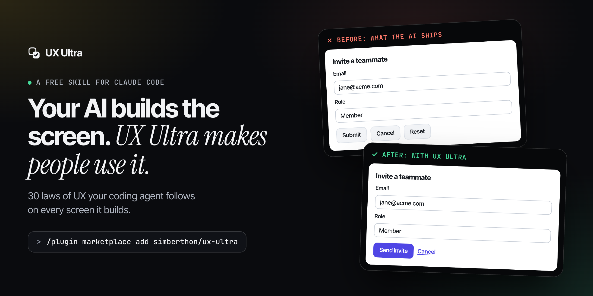
</p>

<p align="center">
  <b>30 laws of UX, written as instructions your coding agent follows on every screen it builds.</b><br>
  Clearer flows, fewer drop-offs, users who come back. Free and open source.
</p>

Install it in Claude Code:

```bash
/plugin marketplace add simberthon/ux-ultra
/plugin install ux-ultra@ux-ultra
```

Then run `/ux-brief` on the next screen you build.

<p align="center">
  <a href="#laws"><b>See the 30 laws</b></a> &nbsp;·&nbsp; <a href="#proof">Proof</a> &nbsp;·&nbsp; <a href="#install">Other ways to install</a> &nbsp;·&nbsp; <a href="#faq">FAQ</a>
</p>

<p align="center"><sub>Built from 15 books, the 10 most-viewed UX videos on YouTube and 100+ cited guidelines (NN/g, WCAG 2.2, Baymard, Vercel).</sub></p>

## AI builds a screen in 90 seconds, and quietly breaks the rules

Ask any AI coding tool for a team settings page. You get one in a minute and a half. It looks fine in a screenshot.

Then a real person uses it. The email field has no label. Three buttons look the same, so nobody knows which one sends. One typo and a red error fires before they finish typing. The server hiccups, and the form comes back empty.


| | Before | After |
|---|---|---|
| 1 | A placeholder instead of a label | A real label, and a pasted list of emails is accepted |
| 2 | "Invalid email" after one keystroke | The role defaults to the safest option, Member |
| 3 | Three equal buttons, the main one greyed out | One solid button, right next to the field |
| 4 | "No data" is the first thing a new admin sees | The invite shows up at once, with Resend |

None of that is a bug your tests will catch. It is a brief nobody wrote. Designers learned these rules the hard way. Your agent never got them.

<sub>The idea of giving an agent its UX laws as a short brief comes from "The UX Laws in My CLAUDE.md" (designbuilding, September 2026). UX Ultra takes that format from 20 laws to 30 and adds a SaaS playbook, accessibility, ethics and a scored review.</sub>

## Bad UX does not crash. It just loses you customers.

Nobody emails you to say your form was confusing. They close the tab. Here is what the research measures.

| Figure | What it measures |
|---|---|
| **70.19%** | Online carts that are abandoned. Source: [Baymard Institute](https://baymard.com/lists/cart-abandonment-rate) |
| **17%** | Shoppers who abandon because the checkout is too long or too complicated. That is a UX problem, and it is fixable. Source: [Baymard Institute](https://baymard.com/lists/cart-abandonment-rate) |
| **12 vs 23.48** | Form elements in an ideal checkout, against the average US checkout. Half the fields, same sale. Source: [Baymard Institute](https://baymard.com/blog/checkout-flow-ux-optimization) |
| **+22% / -42%** | Inline validation on blur, against none: 22% more successful completions, 22% fewer errors, 31% higher satisfaction, 42% less time to finish. Source: [Luke Wroblewski, A List Apart, 2009](https://alistapart.com/article/inline-validation-in-web-forms/) |
| **25%** | Median SaaS activation rate. Three out of four signups never reach the moment your product pays off. Source: [Lenny's Newsletter survey](https://www.lennysnewsletter.com/p/what-is-a-good-activation-rate) |
| **72% vs 16%** | People who finish a 3-step product tour, against a 7-step one. Source: [Chameleon](https://www.chameleon.io/blog/user-onboarding-best-practices) (vendor data, directional) |
| **400 ms** | Under this per interaction, productivity soars. Source: [Doherty and Thadani, IBM, 1982](https://lawsofux.com/doherty-threshold/) |

Retention is built screen by screen. UX Ultra makes your agent get each one right the first time, so you stop paying for the same mistakes in churn.

<a name="laws"></a>

## 30 laws. Each one fixes a screen your AI already got wrong.

Every card shows what an AI ships by default, and what it ships once UX Ultra is installed. Same screen, same design system; only the decisions change.

### The eight that cost the most

#### 1. Reduce choices per screen (Hick's law)

In plain words: the more buttons you show, the longer people freeze.

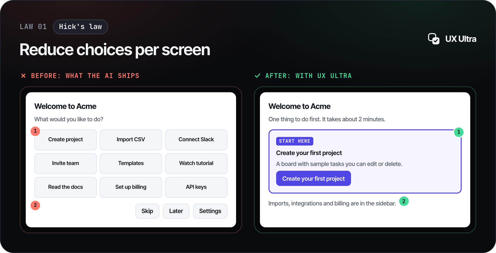

| | Before | After |
|---|---|---|
| 1 | Nine tiles of equal weight. Nothing says where to start. | One main task, clearly the place to start. |
| 2 | Three ways out compete with the way in. | Everything else stays one level deeper, in the sidebar. |

*Why it pays:* people start doing the thing you sell instead of looking around.

#### 4. Make targets large and close (Fitts's law)

In plain words: big buttons near your thumb are easy to hit.

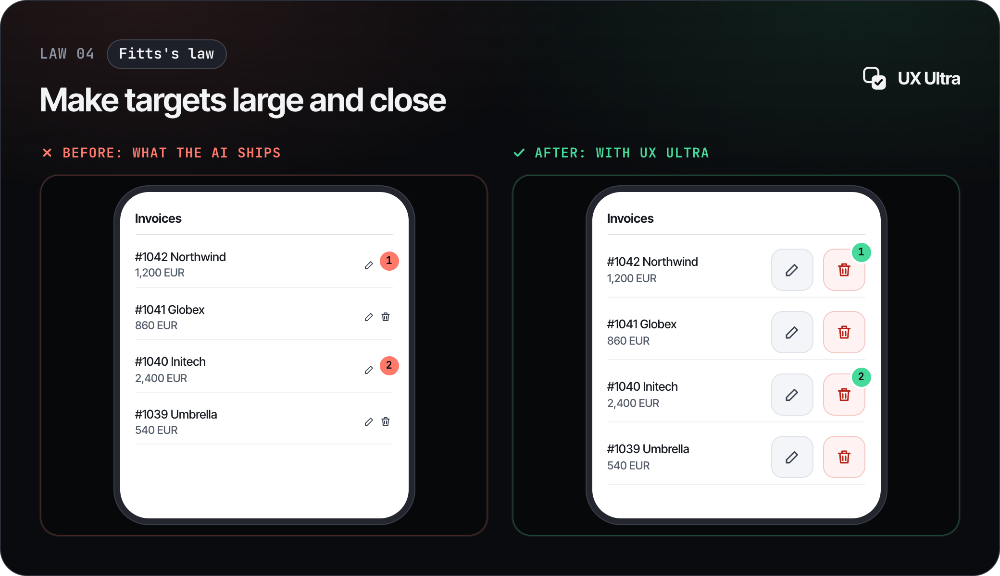

| | Before | After |
|---|---|---|
| 1 | 16 px icons crammed at the edge of the row. | 44 px tap areas, easy for a thumb. |
| 2 | Edit and Delete touch: one slip deletes. | Space between them, and Delete marked as destructive. |

*Why it pays:* fewer mis-taps, fewer angry support messages.

#### 6. Highlight the primary action (Von Restorff effect)

In plain words: the one thing that looks different gets clicked.

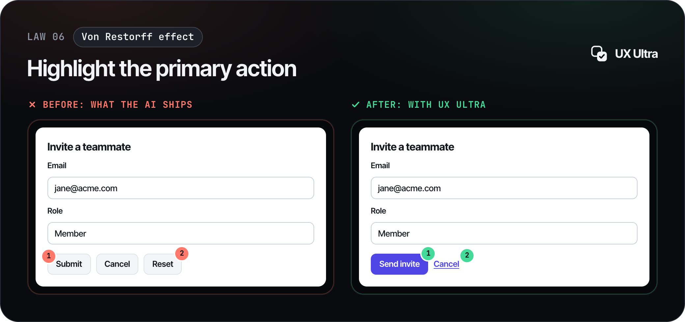

| | Before | After |
|---|---|---|
| 1 | Three identical grey buttons. Which one sends? | One solid button that says what it does. |
| 2 | Reset sits next to Submit and wipes the form. | Cancel is a quiet text link. Reset is gone. |

*Why it pays:* more people hit the button that makes you money.

#### 7. Respond within 400 milliseconds (Doherty threshold)

In plain words: if nothing moves when you click, you click again or you leave.

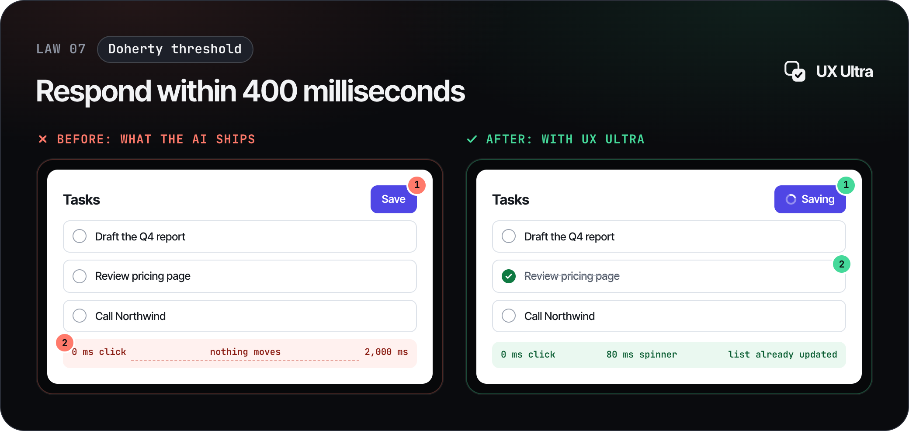

| | Before | After |
|---|---|---|
| 1 | No pressed state, no spinner, no change. | The button answers at once, in about 80 ms. |
| 2 | Two seconds of silence: people click again. | The list updates right away, before the server replies. |

*Why it pays:* the app feels fast, and fast apps get used daily.

#### 19. Break content into chunks (Miller's law and chunking)

In plain words: small groups are easier to read than one long block.

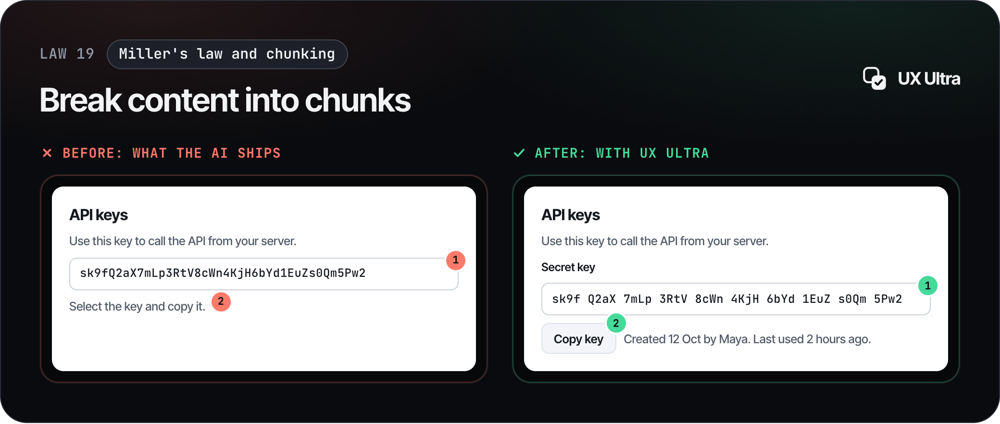

| | Before | After |
|---|---|---|
| 1 | One 40-character string, impossible to check by eye. | The key in groups of 4, easy to compare. |
| 2 | No copy button: select by hand and hope. | One Copy button right next to it. |

*Why it pays:* fewer copy errors, fewer "my key does not work" tickets.

#### 23. Make the goal feel close (Goal-gradient effect)

In plain words: the closer the finish line looks, the faster people run.

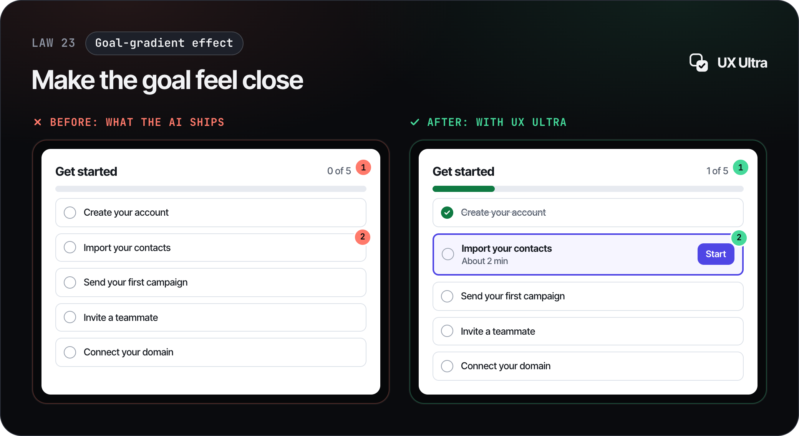

| | Before | After |
|---|---|---|
| 1 | Starts at 0 of 5, even after signing up. | An honest head start: "Account created" is ticked. |
| 2 | Every task looks equally far away. | The next step is highlighted, small and timed. |

*Why it pays:* more users finish onboarding and activate.

#### 24. Design the peak and the end (Peak-end rule)

In plain words: people remember the best moment and the last moment.

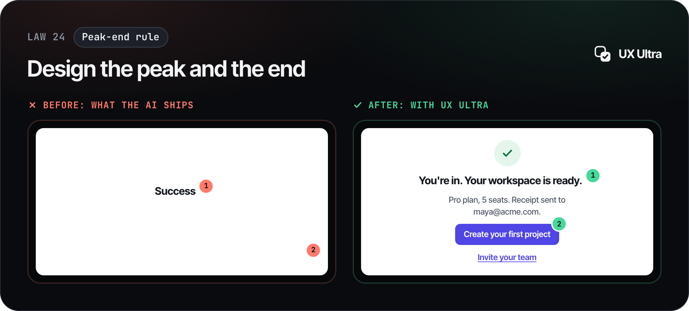

| | Before | After |
|---|---|---|
| 1 | After payment, a blank page that says "Success". | Says what just happened, in plain words. |
| 2 | No next step, so the session ends here. | The next step is one button away. |

*Why it pays:* a good ending is what people tell their friends about.

#### 28. Make errors recoverable (Error recovery)

In plain words: mistakes happen, so make them cheap.

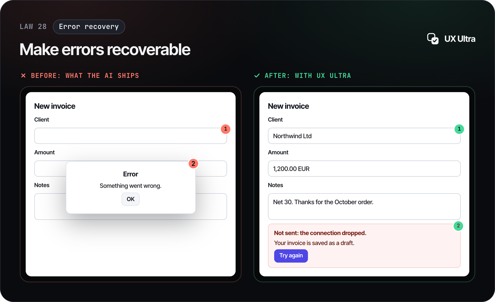

| | Before | After |
|---|---|---|
| 1 | The form comes back empty after the error. | Everything typed stays in the form. |
| 2 | A popup that says nothing about what failed. | Says what failed, what was kept, and how to retry. |

> Inline validation on blur, compared with none: 22% more successful completions, 42% less time to finish. Source: Luke Wroblewski, A List Apart, 2009.

*Why it pays:* nobody leaves because they lost 10 minutes of typing.

### All 30, by family

The eight above, plus 22 more. Open a family to see its before and after.

<details>
<summary><b>Decide and act</b>, laws 1 to 8</summary>

**1. Reduce choices per screen** (Hick's law). Shown in full above: the more buttons you show, the longer people freeze.

**2. Use sensible defaults** (Hick's law, applied)<br>
In plain words: pick the safe answer for them, and let them change it.

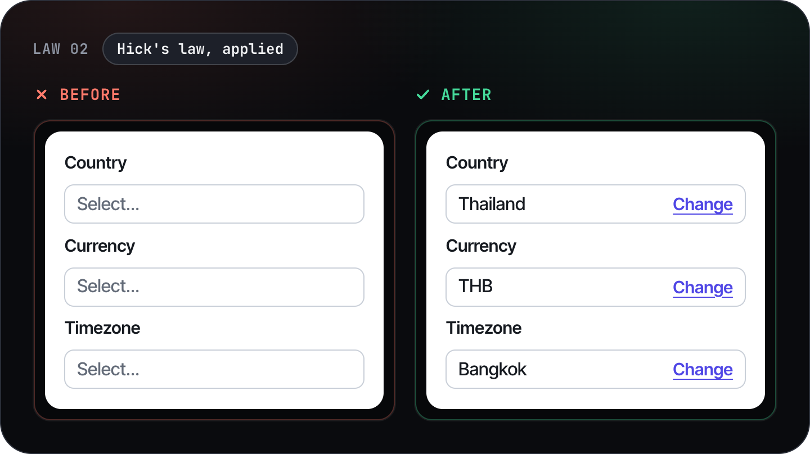

Before: a signup form with empty Country, Currency and Timezone dropdowns.<br>
After: the three fields prefilled from the browser (Thailand, THB, Bangkok), each with a "Change" link.<br>
*Why it pays:* fewer fields to fill means more finished signups.

**3. Avoid choice overload** (Choice overload)<br>
In plain words: too many options and people pick nothing.

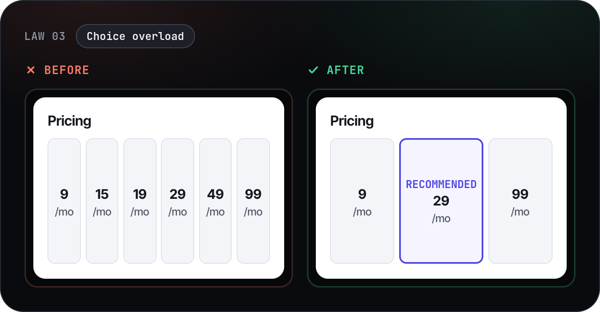

Before: a pricing page with 6 plans in identical columns.<br>
After: 3 plans, the middle one tagged "Recommended".<br>
*Why it pays:* a visitor who can decide is a visitor who can pay.

**4. Make targets large and close** (Fitts's law). Shown in full above: big buttons near your thumb are easy to hit.

**5. Place key actions nearby** (Fitts's law, applied)<br>
In plain words: put the button where the eyes already are.

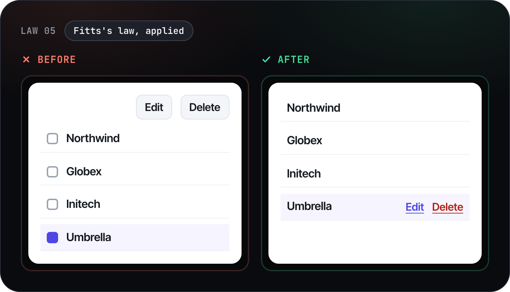

Before: a table where you tick a row, then scroll to the top toolbar to delete it.<br>
After: Edit and Delete sit on the row itself.<br>
*Why it pays:* daily tasks take seconds, so people keep doing them in your app.

**6. Highlight the primary action** (Von Restorff effect). Shown in full above: the one thing that looks different gets clicked.

**7. Respond within 400 milliseconds** (Doherty threshold). Shown in full above: if nothing moves when you click, you click again or you leave.

**8. Cut task time** (Parkinson's law)<br>
In plain words: every extra step is a chance to quit.

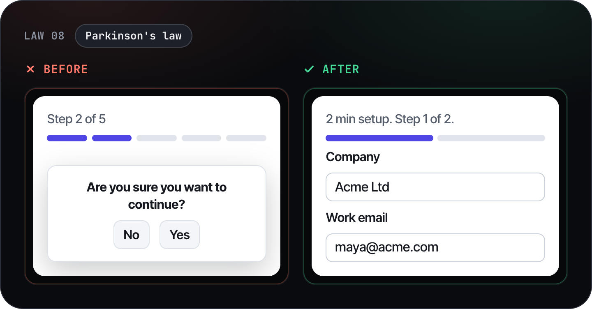

Before: a 5-screen onboarding with an "Are you sure?" between each screen.<br>
After: 2 screens, prefilled, with "2 min setup" written at the top.<br>
*Why it pays:* more people reach the moment your product pays off.

</details>

<details>
<summary><b>Understand at a glance</b>, laws 9 to 17</summary>

**9. Follow familiar patterns** (Jakob's law)<br>
In plain words: people expect your app to work like the apps they already use.

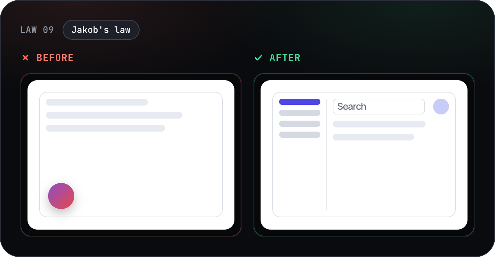

Before: navigation hidden in a custom floating bubble bottom left.<br>
After: a left sidebar, search at the top, avatar menu top right.<br>
*Why it pays:* zero learning curve, so trials turn into habits.

**10. Match the user's mental model** (Mental model)<br>
In plain words: use the user's words, not the database's.

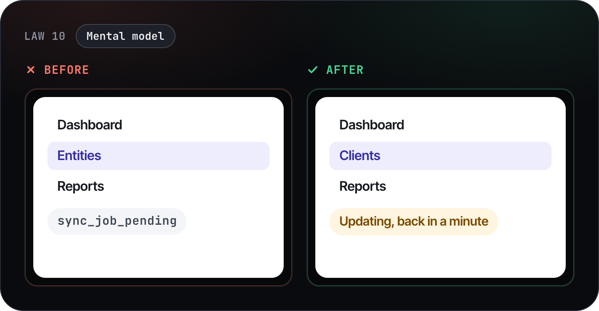

Before: a menu item called "Entities" and a status "sync_job_pending".<br>
After: "Clients" and "Updating, back in a minute".<br>
*Why it pays:* people understand your product without a call to support.

**11. Group related things** (Law of proximity)<br>
In plain words: things close together look like they belong together.

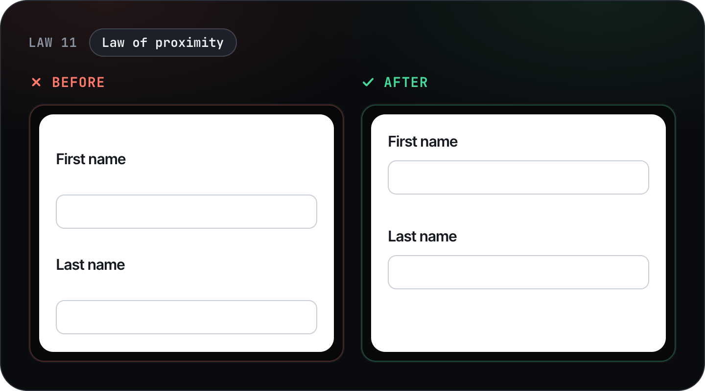

Before: a form where each label floats halfway between two fields.<br>
After: each label sits right on top of its own field, with more space between groups.<br>
*Why it pays:* forms get filled in right the first time.

**12. Use shared regions** (Law of common region)<br>
In plain words: a box around things says "these go together".

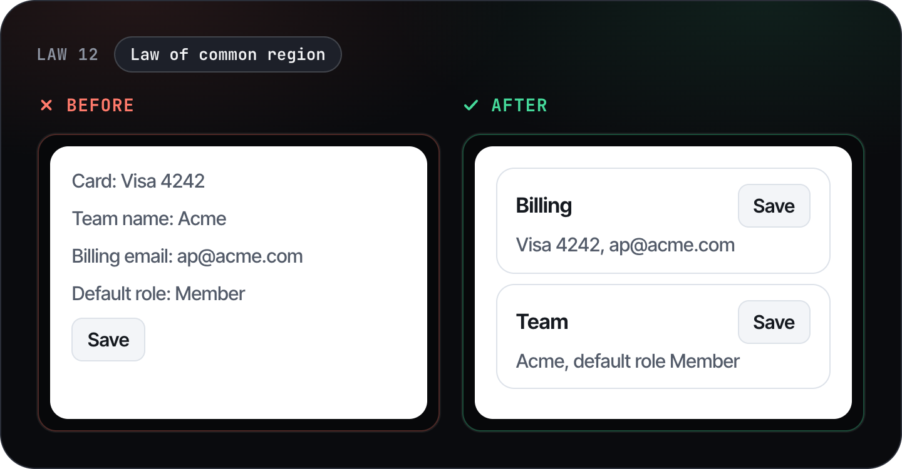

Before: billing details and team settings mixed in one long list.<br>
After: two cards, "Billing" and "Team", each with its own Save.<br>
*Why it pays:* less hunting, fewer wrong changes.

**13. Connect related elements** (Law of uniform connectedness)<br>
In plain words: a line between things shows they are linked.

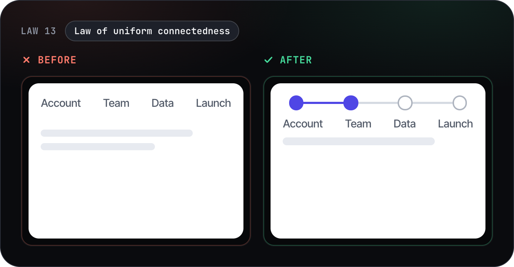

Before: a 4-step setup shown as 4 loose words at the top.<br>
After: a stepper with circles joined by a line, done steps filled in.<br>
*Why it pays:* people see the path and walk it to the end.

**14. Keep patterns consistent** (Law of similarity)<br>
In plain words: if it looks the same, it should act the same.

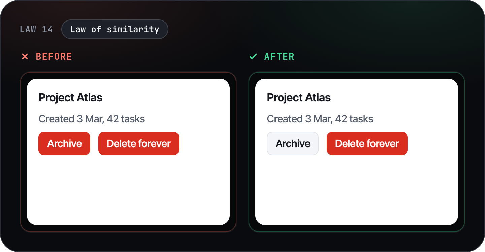

Before: "Archive" and "Delete forever" both styled as red buttons.<br>
After: red only for "Delete forever"; Archive is a normal button.<br>
*Why it pays:* no accidental deletes, no lost trust.

**15. Simplify what people see** (Law of Pragnanz)<br>
In plain words: if it takes more than 5 seconds to get the screen, it is too busy.

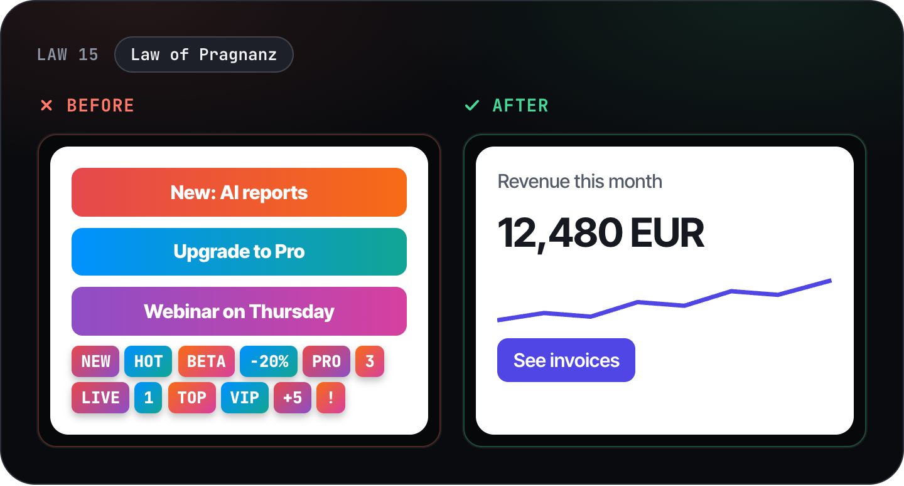

Before: a dashboard with gradients, 3 banners and 12 badges.<br>
After: one headline number, one chart, one action.<br>
*Why it pays:* users find the value in the first visit.

**16. Choose the simplest design that works** (Occam's razor)<br>
In plain words: fewer parts, fewer ways to get lost.

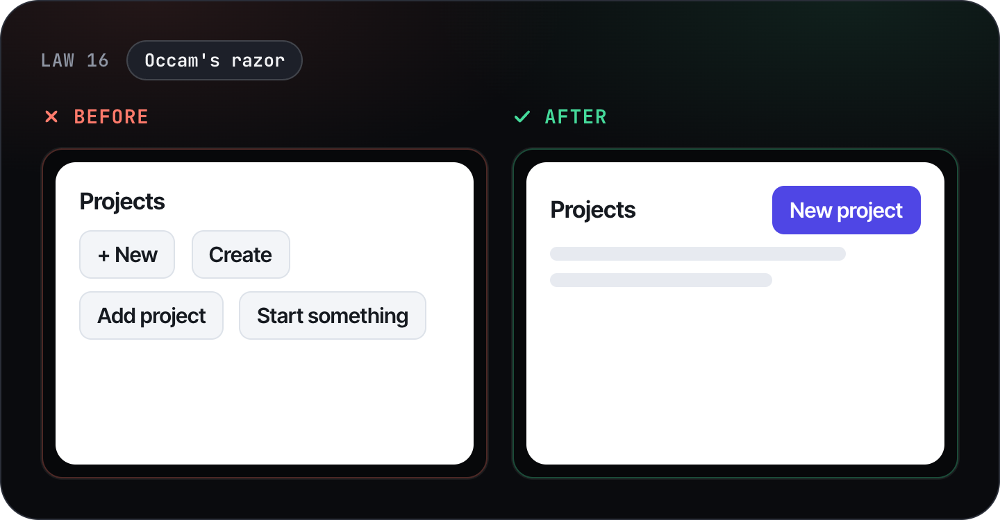

Before: "New project" reachable from 4 different buttons with 4 different names.<br>
After: one "New project" button in one place.<br>
*Why it pays:* less to build, less to support, less to explain.

**17. Control attention** (Selective attention)<br>
In plain words: people only see what is about their current goal.

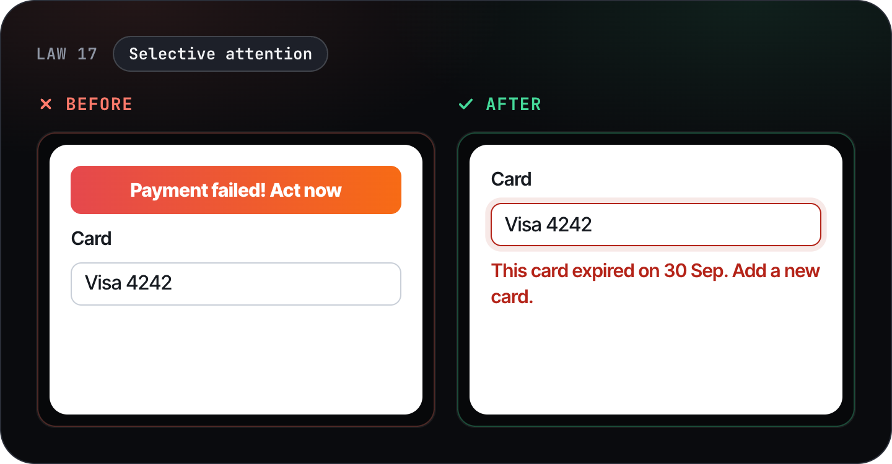

Before: "Payment failed" shown in a colorful banner that looks like a promo.<br>
After: the error sits inline, next to the card field, in plain text.<br>
*Why it pays:* failed payments get fixed instead of ignored.

</details>

<details>
<summary><b>Memory and load</b>, laws 18 to 21</summary>

**18. Lower cognitive load** (Cognitive load)<br>
In plain words: every thing on screen costs a bit of brain power.

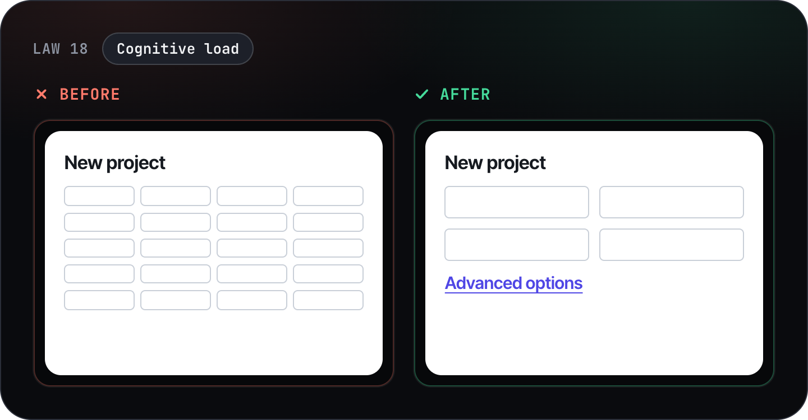

Before: a create form showing all 20 options at once.<br>
After: 4 fields, and "Advanced options" folded underneath.<br>
*Why it pays:* more people finish creating their first item.

**19. Break content into chunks** (Miller's law and chunking). Shown in full above: small groups are easier to read than one long block.

**20. Do not make people remember** (Working memory)<br>
In plain words: show it again instead of asking them to recall it.

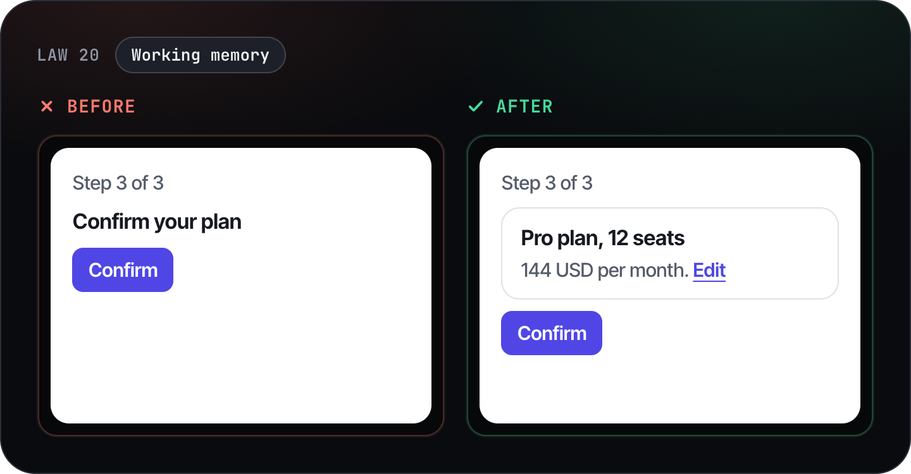

Before: step 3 of checkout asks "Confirm your plan" with no plan shown.<br>
After: a summary box on every step: "Pro plan, 12 seats, 144 USD per month".<br>
*Why it pays:* people buy with confidence instead of going back to check.

**21. Put essentials first and last** (Serial position effect)<br>
In plain words: people remember the start and the end of a list.

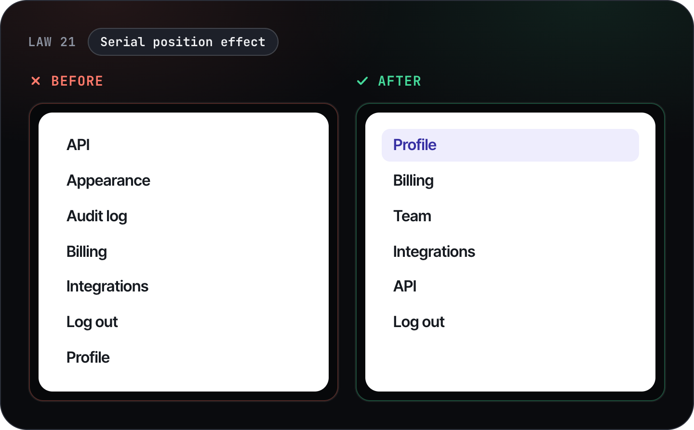

Before: settings menu sorted A to Z, with "Billing" lost in the middle.<br>
After: the most used items first, "Log out" last.<br>
*Why it pays:* key pages get found, key tasks get done.

</details>

<details>
<summary><b>Progress and motivation</b>, laws 22 to 25</summary>

**22. Show visible progress** (Zeigarnik effect)<br>
In plain words: an unfinished task keeps calling you back.

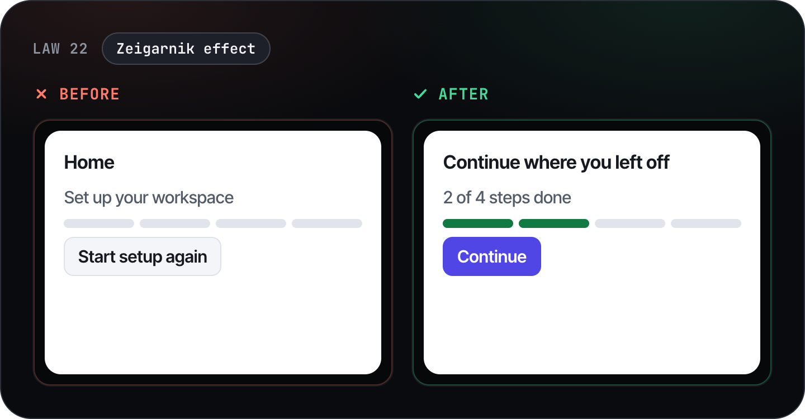

Before: a half-done setup that is lost when the tab closes.<br>
After: "Continue where you left off: 2 of 4 steps done" on the home screen.<br>
*Why it pays:* people come back to finish, which is retention you did not have to buy.

**23. Make the goal feel close** (Goal-gradient effect). Shown in full above: the closer the finish line looks, the faster people run.

**24. Design the peak and the end** (Peak-end rule). Shown in full above: people remember the best moment and the last moment.

**25. Protect flow** (Flow)<br>
In plain words: do not interrupt someone who is busy working.

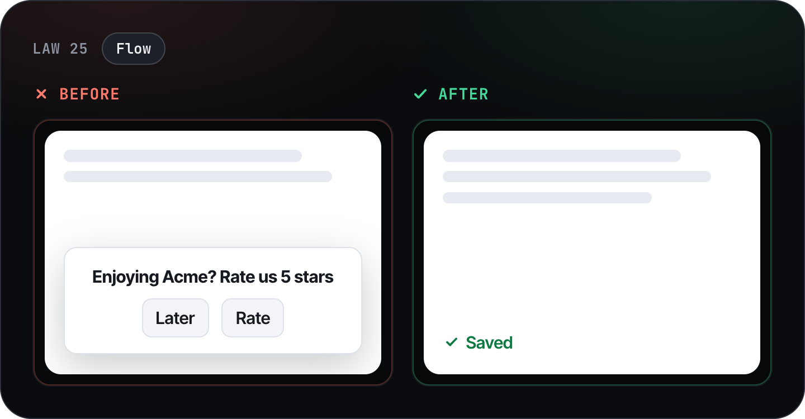

Before: a "Rate us" modal that pops up in the middle of writing.<br>
After: no modal; a small, quiet note after the task is saved.<br>
*Why it pays:* users stay longer and get more done, so they stay subscribed.

</details>

<details>
<summary><b>Errors and complexity</b>, laws 26 to 30</summary>

**26. Accept messy input** (Postel's law)<br>
In plain words: take what people type, and clean it up yourself.

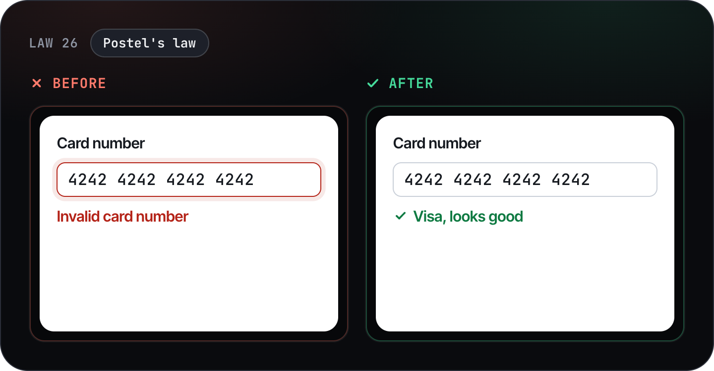

Before: "Invalid card number" because the user typed spaces.<br>
After: spaces accepted and the number shown in groups of 4.<br>
*Why it pays:* fewer failed payments for silly reasons.

**27. Prevent errors** (Error prevention)<br>
In plain words: the best error message is the one nobody ever sees.

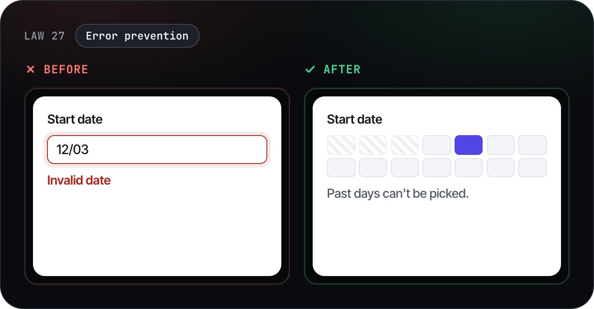

Before: a free text date field that rejects "12/03".<br>
After: a date picker that only allows valid dates.<br>
*Why it pays:* fewer failed forms, fewer support tickets.

**28. Make errors recoverable** (Error recovery). Shown in full above: mistakes happen, so make them cheap.

**29. Move complexity into the system** (Tesler's law)<br>
In plain words: let the code do the hard part, not the user.

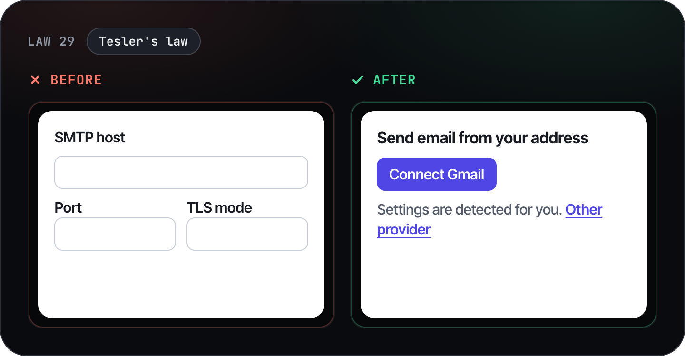

Before: a setup screen asking for "SMTP host, port and TLS mode".<br>
After: "Connect Gmail" button, settings detected automatically.<br>
*Why it pays:* non-technical buyers can set it up alone.

**30. Teach in context** (Paradox of the active user)<br>
In plain words: nobody reads the manual, so put the help where they click.

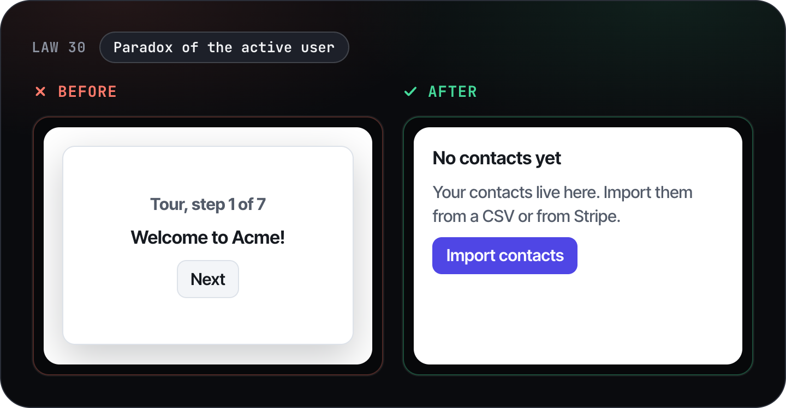

Before: a 7-step product tour on first login.<br>
After: an empty state that says what goes here, with one button to add it.<br>
*Why it pays:* users learn by doing and reach value on day one.

> Chameleon measured 72% completion for 3-step tours against 16% for 7-step ones (vendor data, directional).

</details>


<a name="proof"></a>

## We ran it on a screen an AI built. It scored 15 out of 88.

We gave UX Ultra a typical AI-generated members page ([`examples/invite-before.html`](examples/invite-before.html)) and ran one command, `/ux-review`. Output unedited, Claude Code, 23 October 2026.

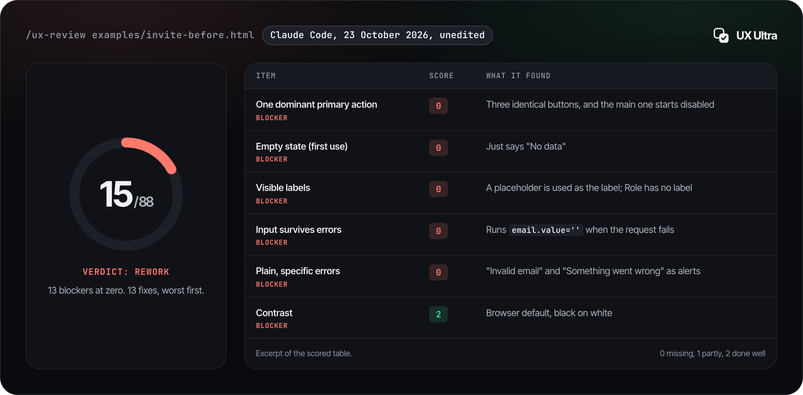

What it caught before any designer looked:

- The invite sent nothing. The request had no body, so the email never reached the server.
- On a server error, the page wiped the email the user had typed.
- An `alert()` popup on every keystroke, from the first letter.
- Three identical buttons, and the main one disabled by default.
- No labels, no visible keyboard focus, and inputs small enough that iOS zooms in.
- "No data" as the empty state, and no message when an invite succeeds.

Then it listed 13 fixes, worst first, each tied to the law it breaks. It changed no code until asked. [Read the full review](examples/ux-review-invite.md).

## Three steps, then it just runs

1. **Install.** One command in Claude Code (above). It also works as a copied skill or a plain rules file for other AI tools.
2. **It briefs.** Before your agent builds a screen, it writes a short brief: who the user is, the shortest path, the one primary action, every state (empty, loading, error, success) and the laws in play.
3. **It reviews.** Run `/ux-review` on any screen and get a score, the blockers, and fixes in order, each tied to a law.

| Command | What it does |
|---|---|
| `/ux-brief <what you are building>` | Writes a 7-line UX brief before any code: user goal, shortest path, primary action, states, risks, done moment, laws in play |
| `/ux-review [file, route, or diff]` | Scores the UI against the checklist and lists fixes, blockers first |

Or simply ask: "Build the billing settings page, use UX Ultra." The skill also loads by itself whenever Claude builds or changes a user interface.

## What is inside

| Part | What it gives your agent |
|---|---|
| **The UX Ultra loop** | Eight steps for every screen: goal, shortest path, obvious next action, no distractions, instant feedback, error prevention, preserved work, clear completion |
| **10 non-negotiables** | The rules that hold on every screen (every state designed, one primary action, visible labels, input survives errors, undo beats confirm...) |
| **30 laws of UX** | Hick, Fitts, Jakob, Doherty, peak-end, Tesler, Zeigarnik and more, each as one principle plus four instructions |
| **Heuristics** | Nielsen's 10, Norman's principles, Krug's laws, Cooper's postures |
| **SaaS playbook** | Onboarding, navigation, forms, tables, dashboards, feedback, errors, settings, billing, notifications, microcopy, accessibility, mobile, motion, AI features, metrics |
| **Review checklist** | A scored pre-ship audit with blockers, used by `/ux-review` |
| **AI default mistakes** | The 22 things AI coding tools get wrong unless told otherwise |
| **Sources** | 15 books, the 10 most-viewed UX videos on YouTube, and 100+ guidelines and articles |

<a name="install"></a>

## Install

### Option 1: as a Claude Code plugin (recommended)

```bash
# In Claude Code
/plugin marketplace add simberthon/ux-ultra
/plugin install ux-ultra@ux-ultra
```

### Option 2: copy the skill

```bash
git clone https://github.com/simberthon/ux-ultra.git
cd ux-ultra
./scripts/install.sh            # for all your projects (~/.claude/skills)
./scripts/install.sh --project  # run from a project root to install it there only
```

### Option 3: just the rules

No Claude Code? Paste [`templates/CLAUDE-snippet.md`](templates/CLAUDE-snippet.md) into your `CLAUDE.md`, `AGENTS.md`, `.cursorrules`, or any system prompt. It is the compact version of the skill.

## For whom

- Founders building a SaaS or an app with AI who have no designer yet.
- Developers who want screens that pass a design review on the first try.
- Students learning UX who want the laws in plain words with real examples.
- Teachers who need a free, sourced reference to work from in class.

<a name="faq"></a>

## FAQ

<details>
<summary><b>Is it free?</b></summary>

Yes. MIT license. No account, no upsell.
</details>

<details>
<summary><b>Do I need to know design?</b></summary>

No. The skill knows the laws so you do not have to. Each fix comes with the reason, so you learn as you go.
</details>

<details>
<summary><b>Does it only work with Claude Code?</b></summary>

It is built as a Claude Code skill. The same rules also ship as a plain rules file you can give to other AI coding tools.
</details>

<details>
<summary><b>Will it change my code without asking?</b></summary>

No. The review reports and stops. It applies fixes only when you tell it to.
</details>

<details>
<summary><b>Will it change how my app looks?</b></summary>

No. UX Ultra owns behavior: what the screen is for, what happens on click, how it fails, how it ends. Your design system keeps owning colors, fonts and spacing. Every before and after above uses the same visual style on both sides.
</details>

<details>
<summary><b>Where do the rules come from?</b></summary>

From 15 books, the 10 most-viewed UX videos on YouTube and 100+ guidelines, including NN/g, WCAG 2.2, Baymard and Vercel. Every source is listed in [`references/sources.md`](skills/ux-ultra/references/sources.md).
</details>

## Documentation

The full guide lives in the [wiki folder](wiki/Home.md): how the skill works, every law with examples, the SaaS playbook, the UX Ultra Academy (curriculum built from the best books and most-viewed videos), a teaching kit for workshops, and an FAQ.

Principles behind the project:

- **Laws, not a style guide.** A model can reason from a principle. It can only copy from a spec.
- **Behavior, not branding.** UX Ultra decides what the screen is for and how it behaves. Your design system decides how it looks.
- **A tiebreaker, not a checklist.** When rules conflict: clarity, accessibility, user control, task completion. Do not apply them mechanically.
- **Every rule has a source.** See [`sources.md`](skills/ux-ultra/references/sources.md).

## Give your agent the brief it never got

Install it once. Every screen after that starts from 30 laws instead of a guess.

```bash
/plugin marketplace add simberthon/ux-ultra
/plugin install ux-ultra@ux-ultra
```

Then run `/ux-brief` on the next screen you build.

## Credits and license

Created by Simon Berthon. The law format (name, one sentence, four instructions) and the eight-step implementation loop were inspired by "The UX Laws in My CLAUDE.md" (designbuilding, September 2026). Law definitions quote Jon Yablonski's [lawsofux.com](https://lawsofux.com). The before and after images are drawn in HTML and rendered by [`assets/src/render.mjs`](assets/src/render.mjs).

MIT. See [LICENSE](LICENSE).
